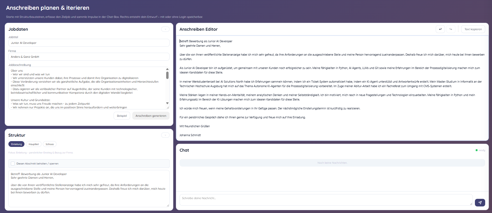
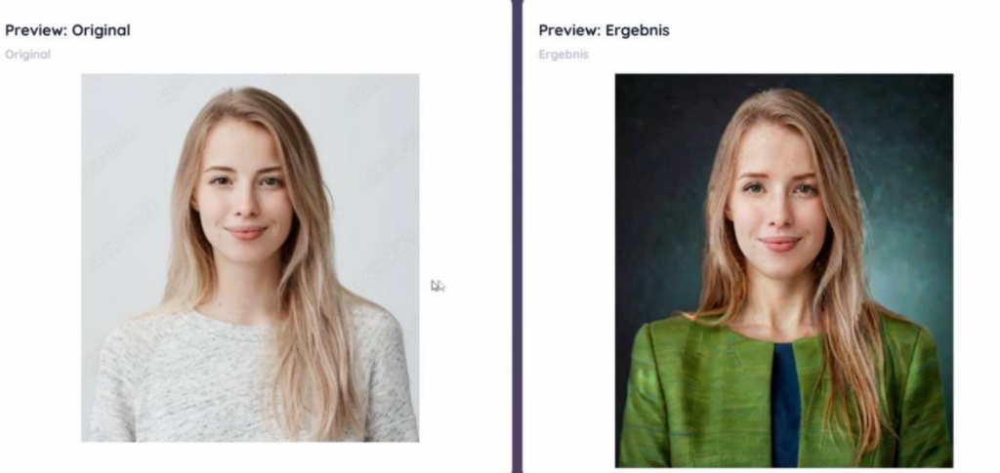
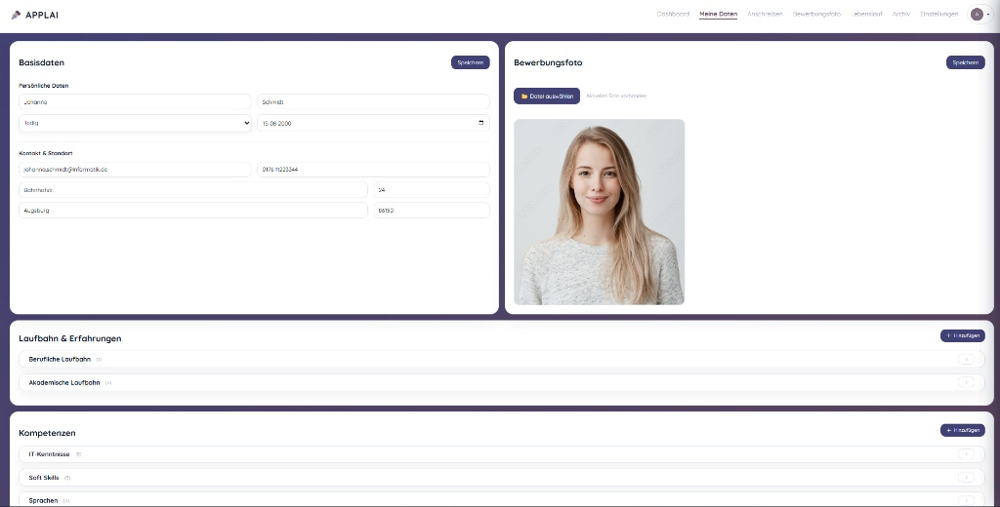
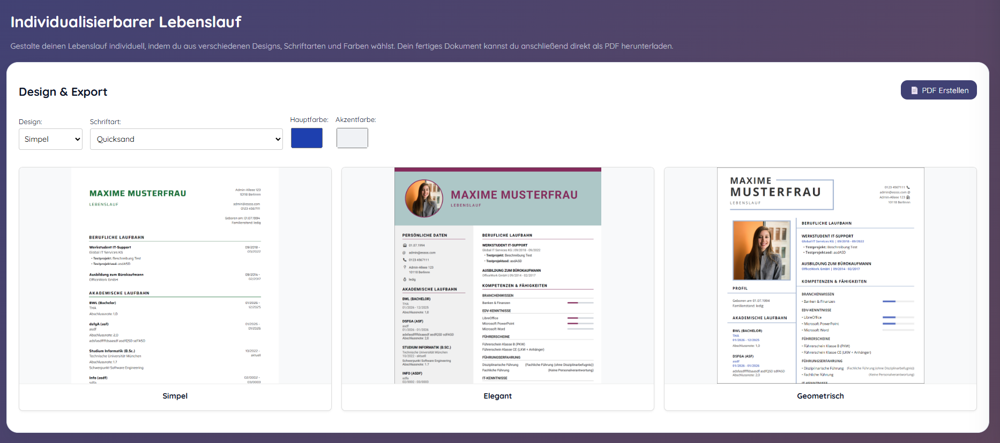

# ApplAI

ApplAI ist eine Full-Stack-Webanwendung auf Basis von Django, mit der Bewerbende ihre vollständigen Bewerbungsunterlagen schrittweise erstellen, iterativ verfeinern und durch lokal betriebene KI-Modelle optimieren können.

## Funktionsumfang

| Modul | Beschreibung |
| :--- | :--- |
| **Dashboard** | Zentrale Übersicht über alle Bewerbungsmodule und den aktuellen Bearbeitungsstatus |
| **Meine Daten** | Strukturierte Pflege persönlicher Stammdaten, beruflicher Stationen und Kompetenzen |
| **Anschreiben** | Jobdaten-Erfassung, KI-gestützte Generierung (Ollama), Chat-Iteration und Live-Editor |
| **Bewerbungsfoto** | KI-gestützte Portrait-Optimierung und Studio-Generierung über ComfyUI (SDXL) |
| **Lebenslauf** | Individualisierbare CV-Layouts (*Simple*, *Elegant*, *Geometric*) mit PDF-Export via Playwright |
| **Archiv** | Persistente Speicherung von Stellenanzeigen, Anschreiben-Entwürfen und Foto-Sessions |

UI-Zustände wie geöffnete Akkordeons und aktive Tabs werden über `localStorage` im Browser gespeichert.

## Projektkontext & Mein Beitrag

ApplAI entstand als Teamprojekt im Rahmen des Studiums an der Technischen Hochschule Augsburg. Ziel war es, klassische Webentwicklung mit lokal ausführbaren generativen KI-Modellen datenschutzfreundlich in einer Anwendung zu vereinen.

**Meine Schwerpunkte im Projekt:**
* **Konzeption & Umsetzung des Anschreiben-Moduls:** Entwicklung der kompletten UI- und Interaktionslogik zum Planen und Iterieren von Anschreiben – inklusive Live-Editor (mit Undo/Redo-Verlauf), integriertem KI-Chat zur gezielten Textüberarbeitung sowie modularer Struktursteuerung (*Einleitung*, *Hauptteil*, *Schluss*) mit Sperrfunktion einzelner Abschnitte.
* **ComfyUI-Workflow & Portrait-Pipeline:** Aufbau und Konfiguration des ComfyUI-Workflows für die Bewerbungsfoto-Generierung, sodass hochgeladene Portraits zuverlässig in seriöse Studio-Aufnahmen mit natürlicher Gesichtserhaltung ohne Verzerrungen umgewandelt werden.

## Vorschau

### Anschreiben planen & iterieren *(Eigener Schwerpunkt)*


### KI-Bewerbungsfoto-Generator via ComfyUI *(Eigener Schwerpunkt)*


<details>
<summary><strong>Weitere Ansichten der Gesamtanwendung anzeigen (Meine Daten & Lebenslauf)</strong></summary>
<br>

#### Stammdaten, Stationen & Kompetenzen


#### Individualisierbarer Lebenslauf & PDF-Export


</details>

---

## Tech-Stack

* **Backend & API:** Python, Django 5, Django REST Framework, `drf-yasg`
* **Lokale KI-Integration:** Ollama (LLM-gestützte Anschreiben-Generierung & Chat), ComfyUI / SDXL (Bildgenerierung)
* **PDF-Rendering & Frontend:** Playwright (Chromium HTML-to-PDF), HTML5, CSS3, Vanilla JavaScript
* **Datenbank:** SQLite

## Projektstruktur

```text
applai/
├── accounts/                   # Benutzerverwaltung (Login, Registrierung, Sessions)
├── applai_demo/                # Projekt-Konfiguration, REST-API & Prompt-Templates
│   ├── api_views.py            # REST-Endpoints & Authentifizierungslogik
│   ├── prompt_templates.py     # Prompt-Engineering für die Anschreiben-Generierung
│   ├── settings.py             # Django-Konfiguration (SQLite, Media, Apps)
│   └── urls.py                 # URL-Routing für WebUI und API
├── core/                       # Hauptanwendung: Datenmodelle & Business-Logik
│   ├── models.py               # Datenmodelle (Bewerber, Stationen, Skills, Firmen)
│   ├── forms.py                # Formular-Validierung
│   ├── views.py                # Views für Dashboard, Lebenslauf & Archiv
│   └── admin.py                # Django-Admin-Konfiguration
├── screenshots/                # UI-Screenshots für die Dokumentation
├── static/                     # CSS, JavaScript & Vorschau-Assets
├── templates/                  # HTML-Templates inkl. PDF-Layouts (CV-Vorlagen)
├── manage.py                   # Django CLI Entrypoint
└── requirements.txt            # Projektabhängigkeiten
```

## Installation & Lokaler Start

### 1. Virtuelle Umgebung & Abhängigkeiten

```bash
git clone https://github.com/xdennis090/applai.git
cd applai

python -m venv .venv
source .venv/bin/activate  # Windows: .venv\Scripts\activate

pip install -r requirements.txt
playwright install chromium
```

### 2. Datenbank initialisieren & Server starten

```bash
python manage.py migrate
python manage.py createsuperuser
python manage.py runserver
```

*(Im Entwicklungsmodus legt die Anwendung über die `DEFAULT_ADMIN_*`-Variablen in `applai_demo/settings.py` alternativ automatisch einen Standard-Zugang mit `admin` / `admin123` an.)*

### 3. Optionale KI-Backends (Ollama & ComfyUI)

Für die KI-Funktionen müssen die jeweiligen lokalen Dienste erreichbar sein:

* **Anschreiben-Generierung & Chat:** Laufende Ollama-Instanz unter `http://127.0.0.1:11434`.
* **Bewerbungsfotos (ComfyUI unter `http://127.0.0.1:8188`):**
  * **Custom Nodes** in `ComfyUI/custom_nodes/`: `comfyui_controlnet_aux` und `ComfyUI-ClipSeg` (inkl. `scikit-image` und `opencv-python-headless`)
  * **Checkpoint** in `ComfyUI/models/checkpoints/`: `RealVisXL V5.0` (`.safetensors`)
  * **ControlNet** in `ComfyUI/models/controlnet/`: ControlNet Canny SDXL (gespeichert als `diffusion_pytorch_model.fp16.safetensors`)
  * Über eine `.env`-Datei lassen sich bei Bedarf `COMFYUI_BASE_URL`, `COMFYUI_CHECKPOINT`, `COMFYUI_PHOTO_PROMPT`, `COMFYUI_NEGATIVE_PROMPT`, `COMFYUI_STEPS` und `COMFYUI_TIMEOUT` anpassen.

---

## REST-API-Übersicht

| Endpoint | Methode | Beschreibung |
| :--- | :--- | :--- |
| `/api/register/` | `POST` | Registriert einen neuen Django-User inkl. Bewerberprofil |
| `/api/login/` | `POST` | Authentifiziert den User und startet eine Django-Session |
| `/api/logout/` | `POST` | Beendet die aktive Session |
| `/api/session/` | `GET` | Gibt den aktuellen User- und Profilstatus zurück |
| `/api/profile/` | `GET`, `POST` | Liest oder aktualisiert das gespeicherte Bewerberprofil |
| `/api/jobs/search/` | `GET` | Liefert verfügbare Stellenanzeigen (optional mit Suchparameter) |
| `/api/jobs/bookmarks/` | `GET`, `POST` | Verwaltet gemerkte Stellenanzeigen pro User |
| `/api/assistant/generate/` | `POST` | Generiert einen Anschreiben-Entwurf via LLM und speichert ihn |
| `/api/assistant/history/` | `GET` | Ruft gespeicherte Anschreiben-Entwürfe ab |
| `/api/photos/optimize/` | `POST` | Führt eine prototypische Bildoptimierung inkl. Historie aus |
| `/api/photos/generate/` | `POST` | Generiert ein neues Bewerbungsfoto via ComfyUI (Upload + Prompt) |
| `/api/photos/history/` | `GET` | Ruft bisherige Foto-Sessions ab |